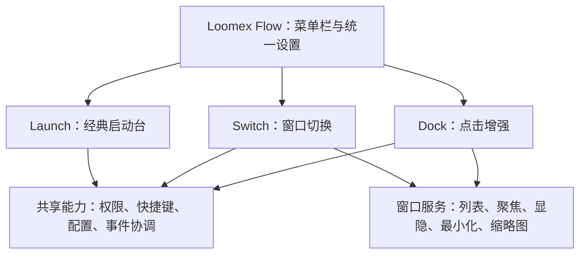

# Loomex Flow 产品与技术规划

日期：2026-11-07。状态：规划草案，尚未开始代码整合。

用户已确定：将 ClassicLaunchpad、基于 AltTab 的窗口切换、Dock 点击隐藏或最小化能力整合为一个 Loomex 品牌工具；整套开源，可接受 GPL。

## 1. 产品命名与定位

推荐产品名：**Loomex Flow**。

- 品牌：Loomex。
- 中文说明：Mac 交互增强工具。
- 推荐仓库名：`loomex-mac`。
- 推荐工程名：`LoomexFlow`。
- 产品介绍：把应用启动、窗口切换和 Dock 交互整合成一套顺手的 Mac 工作方式。

Flow 能覆盖“启动 → 切换 → 收起 → 恢复”的操作过程，后续增加窗口排列等能力也能沿用。备选名称：Loomex Desk（偏桌面工具集）、Loomex Orbit（偏应用与窗口导航）。产品名为建议，尚未开展名称和商标冲突检索。

首版围绕上述三项能力完成闭环。窗口平铺、剪贴板、清理优化、云同步等作为未来独立评估项。

## 2. 功能范围

| 模块 | 面向用户的名称 | 首版范围 | 来源策略 |
| --- | --- | --- | --- |
| Launch | 经典启动台 | 保留现有网格、搜索、分页、文件夹、拖拽、排序、撤销和布局备份 | 迁入 ClassicLaunchpad 1.0.6 |
| Switch | 窗口切换 | Option+Tab、逆向切换、最近使用顺序、窗口标题与图标、窗口预览、隐藏/最小化窗口的选择与恢复 | 基于 AltTab 源码整合 |
| Dock | Dock 增强 | 点击当前应用图标隐藏应用，或按偏好最小化当前窗口；恢复显示；按应用排除 | 优先参考轻量 Dock 项目，复用 Switch 的窗口服务 |
| App Shell | 统一控制中心 | 菜单栏、设置、模块启停、权限说明、快捷键、开机启动、关于与更新 | Loomex 自有应用层 |

Switch 首版优先验证当前桌面窗口；跨 Space、全屏和多显示器行为单独验收，未通过前不承诺完全支持。Dock 悬停窗口预览安排在后续版本，届时复用 Switch 的缩略图服务。

## 3. 开源项目选择

| 项目 | 已核实许可证 | 适合复用的部分 | 选择意见 |
| --- | --- | --- | --- |
| ClassicLaunchpad | 本地现有源码，发布时纳入统一授权与来源说明 | 启动台界面、布局模型、交互与资源释放 | 直接保留现有体验，适配生命周期 |
| lwouis/alt-tab-macos | GPL-3.0 | 窗口发现、顺序维护、选择与聚焦、缩略图、快捷键交互 | 窗口切换的主要基础 |
| oidd/DockMinimize | MIT | Dock 图标识别、点击处理、应用排除和显隐交互 | Dock 功能的优先参考候选，需先验证实现质量 |
| fdamianenriquez/DockTamer | MIT | 精简的点击最小化和恢复逻辑 | 轻量备选与行为对照 |
| ejbills/DockDoor | GPL-3.0 | Dock 点击、窗口交互及兼容性处理 | 作为完整方案参考；避免与 AltTab 同时引入两套窗口引擎 |

DockDoor 本身已有窗口切换和 Dock 增强。如果后续不再要求使用 AltTab，可比较“DockDoor + ClassicLaunchpad”与本方案的维护成本。本规划按用户指定的 AltTab 路线展开。

本次发现的 hatimhtm/Click2Minimize 采用 PolyForm Noncommercial；不作为本项目直接复用来源。同名项目必须按具体仓库及版本判断。

研究基线：

- AltTab：检查了 `ec4f94a8b98a5b9df152af64f74aa4f9f811dd18`，提交时间 2026-11-04；发布页当时列出 v11.10.1。开发前应从通过基线测试的发布标签锁定提交，研究用 master 不等于集成版本。
- DockMinimize：检查了 `af045d228a9be4c2a55f68eb2580c9b1493cfcbc`，提交时间 2026-06-18。
- 本次为选择性源码及文档核对，没有编译或运行这些第三方项目。

## 4. 整合架构

目标是一个可安装的 `.app`，统一菜单栏、设置与生命周期，三个业务模块可以独立启停。首版优先单进程；独立启停不等于进程崩溃隔离，是否增加 helper 由实际稳定性证据决定。

推荐 Swift + AppKit；设置页面可使用 SwiftUI。启动台及窗口切换面板保留 AppKit，减少既有交互和性能的回归风险。采用 Xcode 工程管理应用、资源和签名；内部先按模块组织，不要求首轮把 AltTab 抽成独立 Swift Package。

建议工程职责如下，名称均为待实现的设计：

| 模块/目录 | 职责 |
| --- | --- |
| App | 唯一程序入口、菜单栏、设置窗口、应用显隐、登录启动与退出 |
| Features/Launch | 现有启动台视图、布局模型及持久化 |
| Features/Switch | 切换面板、选择交互及 AltTab 适配层 |
| Features/Dock | Dock 图标识别、点击意图与行为策略 |
| Core | 权限、配置、快捷键和模块间事件协调 |
| Integrations/AltTab | 保留来源记录的上游窗口能力及适配代码 |
| Tests / docs / scripts | 回归验证、设计记录及构建发布 |

窗口服务优先通过 AltTab 适配层提供，Dock 调用同一套窗口动作；不额外建立一套长期运行的窗口扫描、最近使用顺序和缩略图缓存。启动台的应用目录与运行中的窗口列表保持各自业务语义。

当前 ClassicLaunchpad 的 `main.swift` 负责自己的 NSApplication 与 AppDelegate；迁入后应由 Loomex 应用层接管启动入口，将显示、收起和应用启动行为接到 Launch 模块。原 `build.py` 不能直接承担全部第三方框架、资源与签名任务。

## 5. 统一交互

- 菜单栏提供“打开启动台”“设置”“暂停增强功能”和三个模块的状态。
- 可以在 Dock 中保留 Loomex 图标；点击自身图标始终打开启动台，自身不参与 Dock 隐藏规则。
- 默认窗口切换键为 Option+Tab（即 Alt+Tab），支持 Option+Shift+Tab 逆向选择；Command+Tab 保持系统行为，后续可提供用户主动选择的替代模式。
- 启动台快捷键可配置；首次设置时检测 Loomex 内部冲突，并提示已知系统保留组合。第三方应用的全部快捷键无法可靠枚举，需允许用户调整。
- 打开 Switch 时先收起 Launch；设置窗口录入快捷键时暂停对应拦截，避免误触发。
- 窗口选择完成时，如窗口被隐藏或最小化，应先恢复再聚焦；MRU 顺序只记录真实聚焦结果，避免 Loomex 面板抢占顺序。
- 已安装的原版 AltTab、其他 Dock 增强工具可能同时响应。提供共存提示和模块开关，避免重复注册同一快捷键或重复处理同一次点击。

## 6. Dock 的行为规则

“隐藏应用”会隐藏该应用的全部窗口；“最小化窗口”只改变指定窗口的最小化状态。界面必须明确区分这两种动作。

建议默认：**再次点击当前应用的 Dock 图标时隐藏整个应用**。可选：最小化当前窗口。最小化全部窗口放到后续版本，避免首版恢复状态过于复杂。

| 点击前的状态或操作 | 预期行为 |
| --- | --- |
| 应用尚未运行 | 交给系统启动 |
| 应用已运行，但不是前台应用 | 正常激活；按需恢复被 Loomex 收起的窗口 |
| 应用是前台应用，并有可操作窗口 | 按用户选择隐藏应用或最小化当前窗口 |
| 应用被隐藏，或窗口被 Loomex 最小化 | 恢复相关状态并激活；不顺带展开用户之前主动最小化的其他窗口 |
| 应用没有普通窗口 | 保留系统重新打开/新建窗口行为，避免新窗口刚出现就被收起 |
| 右键、拖动、带修饰键点击、特殊 Dock 项目 | 保持原行为，首版不拦截 |
| Finder、全屏窗口、模态对话框或不可最小化窗口 | 明确能力判定；不能可靠处理时放行，支持应用排除 |

点击判断使用系统处理前记录的前台状态，避免“第一次点击只想切过去，却被误当作再次点击”。同时验证鼠标按下/抬起、短拖和 Dock 图标重排，不让拦截破坏原有拖拽。

事件回调保持轻量，不在回调中同步等待跨进程 AX 调用；窗口查询与动作须有超时和失效处理。Dock 位置、放大、自动隐藏和多屏变化后，图标命中缓存需要更新，不能只依赖固定屏幕坐标。

## 7. 权限与降级

| 能力 | 计划需要的权限 | 未授权时 |
| --- | --- | --- |
| 启动台、搜索、布局整理 | 通常不需要辅助功能或屏幕录制 | Launch 可独立使用 |
| 窗口发现与控制、Switch、Dock 增强 | 辅助功能 | 禁用依赖控制的能力，显示模块级说明 |
| 窗口缩略图 | 屏幕录制 | Switch 降级为图标列表；标题按系统可读取情况展示 |
| 全局键鼠事件 | 取决于采用的事件机制；可能涉及输入监控 | 技术验证阶段确定最小权限集合，不提前要求所有权限 |

按模块和功能申请权限。授权被撤销后及时降级，不循环弹窗。统一窗口服务确保多个模块不会重复请求同一种权限。

缩略图在本机内存中按需生成与缓存；面板收起后停止不必要捕获并回收缓存。默认诊断不记录窗口标题、输入内容或截图。

## 8. AltTab 整合的主要工作

AltTab 是完整应用，其入口、全局状态、窗口追踪、权限、设置和 UI 互有关联。检查到的代码还包括 WindowServer/SkyLight/CGS 交互及第三方组件；不能按“导入一个库”估算。

建议先建立固定版本的可运行基线，再增加 Loomex 适配层，逐步统一设置与生命周期，保留清晰的上游修改记录。不要第一步就重写全部窗口基础设施。

重点验证：

1. 新 Bundle ID 和 Loomex 签名身份下，窗口枚举、聚焦、缩略图及授权流程是否正常。
2. 未授权、授权撤销、睡眠唤醒、应用卡顿和窗口失效时是否可恢复。
3. 私有系统接口的调用边界与各系统版本兼容性；集中封装，失败时降级。
4. 上游更新、Pro 授权、崩溃上报等与 Loomex 自有发行的边界。Loomex 只使用自己的发布地址和明确选择的诊断机制。
5. 第三方框架和资源的许可证、构建来源与分发要求。

## 9. 旧布局迁移

现有布局位置：`~/Library/Application Support/ClassicLaunchpad/`。

建议新产品目录：`~/Library/Application Support/LoomexFlow/`，启动台布局单独放在 Launch 子目录。这些是新产品的设计路径，当前尚未创建。

迁移采用“读取 → 校验 → 备份 → 复制到新目录 → 在新目录写入”的流程。首次使用检测到旧布局时提供导入入口，导入失败保留旧文件并说明原因。测试必须使用独立支持目录。

沿用现有布局、排序撤销和动画偏好语义；为迁移加入版本标记及幂等验证。新旧程序并存时不共同写一个布局文件，避免覆盖彼此整理结果。

## 10. 版本路线与验收

以下为一名熟悉 macOS 原生开发者的粗估工作日，不是完成承诺。上游抽离、私有 API 和多屏问题可能显著改变工期，第 0 阶段后重新估算。

| 阶段 | 预计工作量 | 交付与通过条件 |
| --- | --- | --- |
| 0：技术验证 | 3–5 天 | 固定 AltTab 版本可构建；Dock 点击可验证；明确权限、私有 API、依赖清单及共享窗口边界 |
| 1：产品骨架与 Launch | 4–6 天 | 一个 Loomex 应用、一个菜单栏与设置入口；Launch 保留现有行为；旧布局可安全导入 |
| 2：Switch | 7–12 天 | 切换与逆向选择、MRU、窗口聚焦及恢复、预览/无预览模式通过；与 Launch 无焦点冲突 |
| 3：Dock | 4–7 天 | 隐藏/恢复、最小化当前窗口、应用排除通过；不误处理激活、拖拽和新建窗口 |
| 4：公开测试与发布 | 5–10 天 | 权限和唤醒回归、多屏范围确认、资源监测、签名公证、安装升级与对应源码发布 |

串行合计约 23–40 个工作日，可按约 5–8 周安排首次正式发布；熟悉代码和缩小兼容范围后，功能测试版可更早提供。

- v0.1：统一应用与经典启动台。
- v0.2：加入窗口切换。
- v0.3：加入 Dock 点击增强，形成三项能力闭环。
- v1.0：完成公开测试、稳定性与发布流程。
- 后续：Dock 悬停预览、应用专属规则及经过验证的更多窗口操作。

## 11. 验证策略

- 现有 ClassicLaunchpad 验证报告记录 59 项测试通过；迁移时先实际复跑，再扩展集成用例，本次未重新执行。
- 对 Dock 点击状态、MRU、恢复范围、配置迁移与失败回退增加行为测试。
- GUI 验证覆盖中文输入、搜索清除、全部图标命中、拖拽与分页、快捷键取消、焦点切换和模块启停。
- 窗口样本包括 Finder、Safari、Chrome/Electron、微信、多个窗口、无窗口、最小化、隐藏、全屏及模态窗口。
- 系统场景包括权限拒绝/撤销、Dock 重启、睡眠唤醒、显示器插拔、Dock 左右底部位置及自动隐藏。
- 性能分别记录空闲、启动台显示、Switch 显示、收起后的 CPU、physical footprint 和捕获活动；使用一致布局与测量条件。沿用现有收起释放设计，面板隐藏后不持续抓图。
- 能在 CI 中运行的模型测试自动化；权限、真实 Dock 和图形会话行为保留 macOS 本机验收，不能用编译通过代替 GUI 通过。

## 12. 平台与分发

首版优先 Apple Silicon，沿用当前项目已验证的硬件基础。最低构建目标暂定 macOS 13；实际支持范围以组合应用的系统测试结果公布，不能将现有项目或上游的构建目标当作 Loomex 已验证兼容性。

Intel 支持及 Universal 包后续另做完整验证。优先 GitHub Releases / 自有网站分发 DMG，采用 Developer ID 签名与公证。Mac App Store 暂不作为首发渠道，待私有 API 和沙盒约束评估后再决定。

每个版本提供匹配的源码标签、构建说明、依赖锁定信息与发布说明。自动更新只访问 Loomex 自己的发布渠道。

## 13. GPL 与品牌

整合程序按 GPL-3.0 路线发布。具体 `only` / `or-later` 声明必须根据选定上游版本及依赖逐项确认，不擅自扩大授权范围。

- 保留原作者版权、许可证及修改记录，提供开源致谢页面。
- 在二进制下载位置提供对应版本完整源码及必要构建脚本，确保依赖可取得。
- MIT 复用部分保留其原始许可和版权说明。
- 使用 Loomex 自己的图标、名称和产品说明，明确与上游的关系。
- GPL 允许收费分发和商业支持，但不能剥夺接收者依 GPL 获得的源码、修改与再分发权利。
- Loomex 商标及官方发行标识可另行说明；品牌规则不能限制 GPL 授予的代码使用权。

首版建议先免费开源，积累兼容性反馈。后续可评估付费支持或官方发行服务，收费模式保持与 GPL 权利一致。

## 14. 调研来源

核对日期：2026-11-07。来源是当时可读取的页面及指定提交，不代表已完成第三方代码审计。

- [AltTab 仓库](https://github.com/lwouis/alt-tab-macos)
- [AltTab GPL 许可证](https://github.com/lwouis/alt-tab-macos/blob/master/LICENCE.md)
- [AltTab 发布记录](https://github.com/lwouis/alt-tab-macos/releases)
- [AltTab 官方 FAQ：权限、快捷键与开源说明](https://alt-tab.app/faq)
- [检查过的 AltTab WindowServer 设计说明](https://github.com/lwouis/alt-tab-macos/blob/ec4f94a8b98a5b9df152af64f74aa4f9f811dd18/src/windowserver/README.md)
- [DockMinimize 仓库](https://github.com/oidd/DockMinimize)
- [检查过的 DockMinimize 许可证](https://github.com/oidd/DockMinimize/blob/af045d228a9be4c2a55f68eb2580c9b1493cfcbc/LICENSE)
- [DockTamer 仓库](https://github.com/fdamianenriquez/DockTamer)
- [DockTamer 许可证](https://github.com/fdamianenriquez/DockTamer/blob/main/LICENSE)
- [DockDoor 仓库及 GPL 说明](https://github.com/ejbills/DockDoor)
- [Click2Minimize 的非商业许可证说明](https://github.com/hatimhtm/Click2Minimize#license)
- [GNU GPL 官方 FAQ](https://www.gnu.org/licenses/gpl-faq.en.html)

下一步工作应从阶段 0 的固定版本构建与 Dock 点击验证开始，再决定正式集成基线和支持矩阵。
