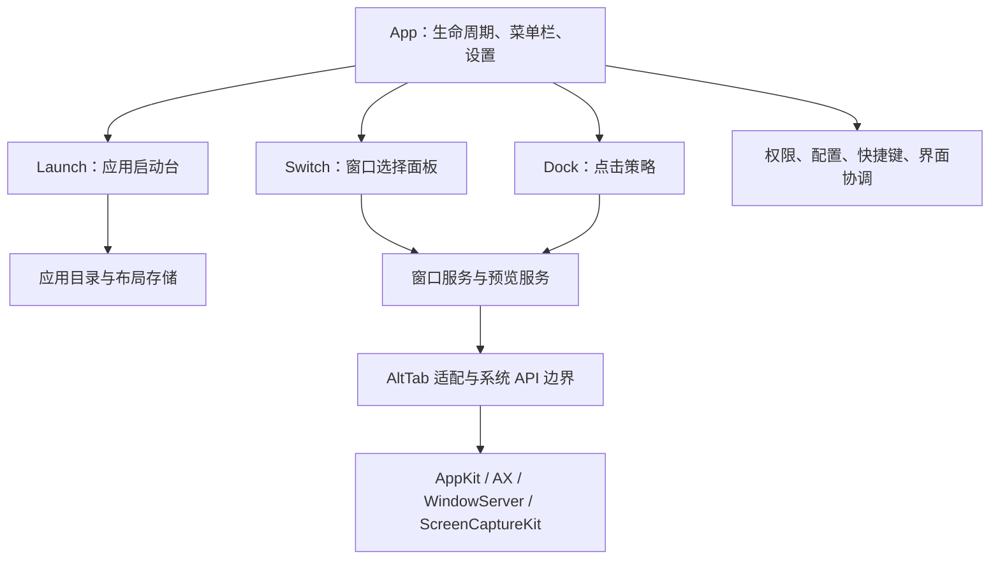

# Loomex Flow 技术选型与整体架构

日期：2026-11-07。状态：供开发采用的架构方案，整合实现尚未开始。

配套文档：[整体需求与开发方案](requirements-and-development.md)。初期构想保留在 [产品规划](loomex-mac-plan.md)。如有冲突，以本文件的技术边界和配套需求文档的行为定义为准。

## 1. 结论与决策依据

推荐 **Swift + AppKit + SwiftUI 的原生 macOS 方案**：AppKit 管理应用生命周期、启动台和窗口切换面板，SwiftUI 承载统一设置；窗口控制通过 Accessibility 与 AltTab 适配层实现，预览通过统一捕获服务提供。首版采用单应用、单主进程、按功能分模块的架构。

项目针对 macOS 的应用与窗口交互，不要求跨平台；已有代码、AltTab 的主要代码和系统 API 均可沿原生路线整合。直接使用原生框架能减少跨语言桥接和已有界面重写。AppKit 与 SwiftUI 的互嵌属于 Apple 支持的集成方式，可通过 NSHostingView / NSHostingController 使用。[Apple：Integrating SwiftUI](https://developer.apple.com/videos/play/wwdc2019/231/)

工作假设是个人或小团队借助 AI 持续开发，优先考虑可调试、可验证和易于维护；未据此假定团队已有 Swift、Rust 或前端经验。性能数字均需在原型阶段测量。

## 2. 已有事实与尚未验证的部分

| 项目 | 当前事实 | 对设计的影响 |
| --- | --- | --- |
| 程序入口 | [Sources/main.swift](../Sources/main.swift) 中的 AppDelegate 创建 NSApplication 生命周期、启动台窗口和布局存储 | 新应用必须接管入口，不能同时保留两个独立 AppDelegate |
| 界面 | [Sources/Interface.swift](../Sources/Interface.swift) 为 AppKit 视图及图层实现 | 保留已有视图，按模块适配，避免全面重写 |
| 布局 | [Sources/Model.swift](../Sources/Model.swift) 的 LaunchLayout / LayoutStore 使用 Codable JSON、校验、原子写及上一版备份 | 延续现有布局格式，迁移目录与模型重写分开进行 |
| 动画 | [Sources/MotionDriver.swift](../Sources/MotionDriver.swift) 对 macOS 14+ 使用显示同步回调 | 继续保留系统版本分支，回调频率不当作 GPU 实际呈现帧率 |
| 构建 | [build.py](../build.py) 使用 swiftc、Swift 5 语言模式及 arm64 / macOS 13 目标 | 新工程迁移前保留此构建基线 |
| 验证 | 初始化提交已在本机完成 59 项测试及构建，GitHub Actions 构建成功 | 作为迁移前证据；本次文档任务未重跑应用测试 |
| 本机工具链 | 当前选中 Command Line Tools；swiftc 报告 Swift 6.0.3；xcodebuild -version 提示需要完整 Xcode | 编写 Xcode 工程、验证 AltTab 前，需要准备完整且与系统匹配的 Xcode |
| 第三方整合 | 尚未导入 AltTab 或 Dock 项目 | 完整整合可行性、依赖漏洞检查和性能预算尚未通过原型验收 |

本次核对了 SDK 头文件：SCScreenshotManager 从 macOS 14 起可用，SCStream 从 macOS 12.3 起可用，SMAppService 从 macOS 13 起可用。SDK 声明证明 API 可用性边界，不能代替对应系统上的运行验证。

## 3. 候选方案比较

以下为针对本项目的工程判断，没有进行各框架的性能对比测试。

| 方案 | 已有代码复用 | 系统交互 | 开发与维护代价 | 本项目选择 |
| --- | --- | --- | --- | --- |
| Swift + AppKit + SwiftUI | 可逐步复用启动台和 AltTab 代码 | 可直接调用 macOS 框架，便于追踪焦点和事件 | 需要掌握 AppKit 生命周期、AX 和并发；系统升级仍有适配成本 | 首选 |
| SwiftUI 为主体，必要处桥接 AppKit | 可复用业务代码，复杂视图仍需桥接 | 浮层、键鼠拦截和跨应用控制最终仍依赖原生底层 | 设置页方便，全面改写现有 AppKit 视图增加回归面 | 用于设置页，核心面板沿用 AppKit |
| Tauri + Web UI + Rust/原生桥接 | 可以调用独立原生模块，但不能直接复用 AppKit 视图为网页 UI | AX、Dock 命中和窗口控制需要额外原生接口 | 同时维护 Web、Rust 和原生边界，跨平台收益在当前需求中有限 | 跨平台成为明确目标时再评估 |
| Electron + Web UI + 原生模块 | 可以桥接 Swift，但窗口与 UI 整合仍要适配 | 原生能力可通过扩展模块接入 | 增加 Chromium/Node 运行环境及原生模块构建链，当前功能不需要网页平台能力 | 首版不采用 |

Tauri 使用 WebView 与 Rust 核心通信；Electron 支持包括 Swift 在内的原生代码接入。因此两者能完成此类功能，但不会消除 macOS 原生开发工作。[Tauri 架构](https://v2.tauri.app/concept/architecture/) · [Electron Swift 原生集成](https://www.electronjs.org/docs/latest/tutorial/native-code-and-electron-swift-macos)

接受的代价：产品与 macOS 深度绑定；需要持续维护系统版本兼容性，部分 AltTab 能力涉及私有接口。未来若增加 Windows/Linux 版本，应复用需求和领域规则，重新评估各平台的系统适配层。

## 4. 推荐技术栈

| 层面 | 推荐技术 | 采用方式 |
| --- | --- | --- |
| 语言 | Swift；必要的 C / Objective-C 桥接 | 迁移期沿用 Swift 5 语言模式，避免把 Swift 6 严格并发迁移与功能整合捆在一次改动中 |
| 应用与窗口 | AppKit、NSApplicationDelegate、NSStatusItem、NSWindow / NSPanel | 一个应用入口；设置、启动台、切换面板按各自焦点需求配置 |
| 设置 UI | SwiftUI，经 NSHostingController 嵌入 | 采用支持最低部署版本的 API；保留 macOS 13 时不以 macOS 14+ Observation 为前提 |
| 启动台 | 现有 AppKit 视图、Core Animation、Core Image | 保留布局和动画语义、相邻页预热与隐藏释放机制 |
| 应用目录 | FileManager、Bundle、NSWorkspace | 已安装应用目录与正在运行的窗口列表分开维护 |
| 窗口控制 | Accessibility / AXUIElement、NSWorkspace、AltTab 适配层 | 优先复用上游窗口追踪与聚焦行为，统一暴露窗口快照及动作 |
| 全局事件 | Core Graphics Event Tap；简单组合键评估系统热键注册 | 普通快捷键和按住修饰键的切换手势分开处理；只注册所需事件 |
| 窗口预览 | 统一 PreviewProvider；优先复用 AltTab 捕获路径，按需接入 ScreenCaptureKit | 界面只消费预览结果，不直接调用不同截图 API |
| 登录启动 | ServiceManagement / SMAppService.mainApp | 由用户主动启用，并展示真实系统状态 |
| 持久化 | Codable JSON、原子文件替换和备份 | 布局、模块设置分开保存；首版无需引入数据库 |
| 并发 | MainActor / 主线程 UI，专用 AX 工作队列，异步捕获与有界缓存 | 不在主线程或事件回调里执行可能卡住的跨进程查询 |
| 诊断 | OSLog / Logger，按需性能采样 | 默认不记录输入、窗口标题和截图 |
| 工程 | Xcode 工程；第三方依赖优先 Swift Package Manager | 先建立可运行应用 target，再按实际复用需要拆 package |
| 测试 | 保留现有命令行测试；新工程引入 XCTest | 逐步区分纯逻辑、系统适配、GUI 验证，不一次重写全部测试 |
| 发布 | Developer ID、Hardened Runtime、notarytool、stapler、DMG | 本地开发可继续 ad-hoc；正式分发走独立签名与公证流程 |
| 更新 | v1.0 前评估并锁定 Sparkle 2 | 依赖与签名流程通过后才接入；应用更新仅使用 Loomex 发行渠道 |

Apple 的 SMAppService 支持 macOS 13+ 登录启动管理；外部分发可使用 Developer ID 与公证服务。[SMAppService](https://developer.apple.com/documentation/servicemanagement/smappservice) · [Developer ID 与公证](https://developer.apple.com/developer-id/)

Python 继续作为构建辅助工具，不进入应用运行时。首版按本地功能设计；网络能力限于用户主动发起或明确设置的更新检查。

## 5. 模块架构与依赖方向

采用模块化单体：一个 `.app`、一个主进程、一个应用 target，内部按业务职责分目录。目录和服务名称均为规划，当前仓库只有 Sources/ 与 Tests/ 基线。

| 规划目录 | 主要职责 | 依赖约束 |
| --- | --- | --- |
| Sources/App | 应用入口、菜单栏、设置承载、模块装配、退出清理 | 创建并协调功能模块；核心服务不反向依赖 App |
| Sources/Features/Launch | 现有启动台视图、布局、搜索和整理 | 依赖应用目录及布局存储，不依赖 Switch 的 UI |
| Sources/Features/Switch | 切换交互、选择状态和窗口面板 | 通过窗口服务操作窗口，不让上游全局单例扩散到其他功能 |
| Sources/Features/Dock | Dock 命中、点击判定、排除规则 | 使用同一个窗口服务；不再建立独立窗口引擎 |
| Sources/Core | 权限、配置、快捷键注册、界面协调与共享值模型 | 只放已有多个调用方的公共能力，避免变成业务杂物箱 |
| Sources/Integrations/AltTab | 锁定的上游代码及 Loomex 适配 | 保留来源、修改记录，集中封装私有 API |

各功能可独立启停，但单进程内存崩溃会影响整个应用。只有原型证明特定工作负载需要隔离时，再引入 XPC/helper；引入前重新验证权限身份、IPC 和退出行为。

共享窗口服务必须在仅启用 Dock 时也能按需启动；不能依赖“Switch 面板必须启用”。预览服务只在需要缩略图的功能启用并有权限时工作。

## 6. 生命周期、状态和焦点

应用层统一维护“用户希望启用”和“当前实际可用”两个状态。模块有效状态至少区分：已关闭、等待权限、运行中、暂停、故障；缩略图不可用是 Switch 的能力降级，不直接等同于整个模块故障。

- 手动首次启动进入引导；登录启动只显示菜单栏，等待用户打开面板。
- Launch 与 Switch 同时最多显示一个交互面板；设置页面录入快捷键时暂停对应快捷键处理。
- Loomex 自身面板不进入窗口候选和最近使用排序。
- 关闭或暂停模块时撤销对应事件订阅、取消尚未执行的动作，保留用户配置。
- 退出释放 event tap、AX observer、定时器和捕获任务，避免遗留拦截；不顺带恢复用户所有已最小化窗口。
- 存储损坏隔离到受影响模块：例如布局无法读取时保护原文件并禁用 Launch，菜单栏和其他可用功能继续工作。

首期保留上游内部实现，通过适配层逐步接入上述生命周期；在移除上游入口前必须证明唯一 NSApplication 生命周期成立。

## 7. 窗口与输入数据流

窗口服务提供不可变的窗口快照，至少表达应用身份、进程、会话内窗口标识、标题可用性、最小化/隐藏状态、Space/显示器信息可用性及动作能力。上游 AXUIElement 等句柄留在适配层。

窗口 ID 与 PID 会被复用，不能单独作为跨启动持久标识。恢复记录必须绑定当前进程/窗口代次；窗口关闭、应用重启后失效。窗口选择与 Dock 点击触发动作前再次检查目标能力和存活状态。

输入处理分为三步：

1. 事件回调读取已准备好的快照，记录点击前的前台应用、坐标、修饰键和拖动轨迹。
2. 纯策略判断是正常系统行为、隐藏应用、最小化目标，还是恢复 Loomex 收起的窗口。
3. 系统适配层异步执行，收到结果后更新窗口状态；超时或目标消失时回报可处理结果。

Dock 普通点击与拖动需要按完整的按下/移动/抬起序列验证。回调中禁止同步 AX 查询、文件 I/O、网络请求或截图；不能可靠识别时保留系统处理。会话级 event tap 的行为和权限在阶段 0 验证。[Apple：CGEvent.tapCreate](https://developer.apple.com/documentation/coregraphics/cgevent/tapcreate(tap:place:options:eventsOfInterest:callback:userInfo:))

AX 调用设置有界超时；超时不等于能强制取消已发出的系统调用。使用隔离工作队列、限制并发和丢弃过期结果，避免阻塞 UI 或不断积压任务。

## 8. 预览、缓存和系统版本

首先接入上游已有捕获能力，确保 Loomex UI 只面向统一 PreviewProvider。之后在该边界内替换或增加 ScreenCaptureKit 实现，不同时重写窗口追踪和捕获引擎。

| 运行环境 | 预览路线 | 失败或权限不足 |
| --- | --- | --- |
| macOS 14+ | 可评估 SCScreenshotManager 按窗口截图 | 使用图标和可取得的标题，不阻断窗口切换 |
| macOS 13 | 验证上游兼容路径或 SCStream 取帧 | 没有通过运行验证前不宣称该系统上的预览可用 |
| 隐藏、最小化、受保护或当前不可捕获窗口 | 视系统能力使用带时效标记的缓存或占位 | 不显示黑图冒充实时预览，不承诺全部窗口实时可见 |

ScreenCaptureKit 用于捕获显示器、应用或窗口的内容，具体截图 API 的版本边界需要分别处理。[Apple：ScreenCaptureKit](https://developer.apple.com/documentation/screencapturekit) · [WWDC23：截图能力](https://developer.apple.com/videos/play/wwdc2023/10136/)

缩略图按显示尺寸与缩放比例生成，缓存有数量和字节上限；面板收起后停止不必要捕获。窗口服务的存活不等于预览捕获持续运行。缓存结果只在内存中使用，退出和锁屏等场景应释放敏感图像。

最低部署目标暂定 macOS 13、首发优先 Apple Silicon；正式支持列表只包含完成相应功能矩阵的系统。Intel/Universal 另行验收。

## 9. 配置、布局与迁移

新应用规划使用 `~/Library/Application Support/LoomexFlow/`：

| 相对路径 | 内容 |
| --- | --- |
| config.json | 带 schemaVersion 的模块开关、快捷键、Switch 偏好、Dock 全局模式和应用排除 |
| Launch/layout.json | 延续当前 LaunchLayout 版本和数据语义 |
| Launch/layout.json.backup | 上一版有效布局 |
| Launch/preferences.json | 原有动画手感等启动台偏好 |
| Launch/sort-undo.json | 原有排序撤销快照 |
| Backups/ | 导入或升级前的版本化备份；保留策略在迁移实现中明确定义 |

这些是拟采用的路径，尚未由当前程序创建。系统权限和 SMAppService 状态由系统查询，不将 config.json 中的布尔值视为授权事实。

配置写入串行化，先校验，再原子替换；读取未知版本时保护文件并说明不兼容。布局损坏不自动清空；普通偏好损坏可在保留损坏副本后恢复默认，并给出提示。

旧目录 `ClassicLaunchpad/` 只作为导入源。迁移先校验和备份，再复制到新目录，验证后标记完成；重复导入不能静默覆盖新布局。新应用后续只写自己的目录，回退旧应用仍能使用旧布局。

应用/窗口运行状态、缩略图和临时恢复记录不写入长期配置；导出诊断默认不包含个人应用清单、布局、窗口标题或截图。

## 10. 权限与分发

| 功能 | 权限策略 | 降级行为 |
| --- | --- | --- |
| Launch | 通常无需辅助功能和屏幕录制 | 其余模块未授权时仍可使用 |
| Switch / Dock 窗口控制 | 按需请求辅助功能 | 未授权则停止相关控制和拦截 |
| 缩略图 | 用户开启预览时请求屏幕录制 | 拒绝后继续提供图标模式 |
| 全局事件 | 由所选 API、tap 位置和系统版本验证输入监控要求 | 创建失败或授权撤销后暂停对应事件处理 |
| 登录启动 | SMAppService 由用户设置 | 展示系统实际状态及需批准的情况 |

权限身份与 Bundle ID、签名及系统判断有关；开发期改变身份可能导致重新授权。固定 Loomex 发行身份后重新验证流程，不能继承原版 AltTab 的授权。

首发选择 GitHub Releases / 自有下载页的直接分发，正式包做 Developer ID 签名和公证。App Sandbox 暂不启用为架构前提，待实际 API 与第三方框架核对后配置最小 entitlement。Mac App Store 暂不作为首发目标；公证成功也不等于满足商店审核要求。

GPL-3.0-only 为仓库原创代码的许可。每次引入上游固定提交，记录版权、许可证、复用范围和修改；第三方具体许可版本与依赖兼容性按锁定版本确认。代码开源和 Loomex 商标使用规则分别说明。

## 11. 工程迁移与验证门禁

| 阶段 | 应完成的技术证明 | 未通过时 |
| --- | --- | --- |
| P0-A | 准备完整 Xcode，固定 AltTab 可构建版本，记录依赖与许可 | 保留当前启动台构建，不开始大范围源码抽离 |
| P0-B | 新身份下的窗口枚举、聚焦、最小化/恢复和权限降级 | 调整适配边界或缩小支持范围，记录原因 |
| P0-C | Dock 活跃/非活跃应用、拖动、修饰键、无窗口场景可区分 | 暂不启用拦截，先修正点击策略与事件序列 |
| P0-D | 13/14+ 捕获路径与目标支持矩阵明确 | 将未测系统或能力标为实验/未支持 |
| P0-E | 空闲、面板显示、收起与重复开关有基准数据 | 先分析瓶颈，再确定最终性能预算 |
| v0.1 | 新 Xcode 应用 target 唯一入口，原 59 项测试可运行且行为回归通过 | 回退到前一可运行提交，按文件或职责逐步迁移 |

本次只编写架构和需求文档，不安装 Xcode、不导入第三方源码、不修改 Bundle ID、权限配置或用户布局。

CI 逐步从现有构建脚本迁移到 Xcode 构建；纯逻辑测试可以自动化，真实 Dock、授权及多屏需要带图形会话的验收证据。发布必须关联源码标签、依赖锁定、构建号、签名和对应完整源码。签名凭据仅放在发布环境的受控秘密中。

## 12. 决策与重评条件

| 决策 | 主要替代方案与本次未选原因 | 接受的代价 | 重新评估条件 |
| --- | --- | --- | --- |
| 原生 AppKit + SwiftUI | Web 容器仍要桥接核心系统能力，增加当前项目不需要的技术边界 | 深度绑定 macOS | 跨平台成为有验收标准的主要需求 |
| 模块化单进程 | 预先拆多个 helper 会增加 IPC、权限和签名复杂度 | 无进程级崩溃隔离 | 原型证实某工作负载必须隔离 |
| AltTab 适配层 | 从零实现全部窗口追踪维护成本高；整套并入两个窗口引擎会状态冲突 | 需要维护上游差异和私有 API 兼容性 | 锁定版本在目标系统关键路径无法稳定通过 |
| JSON 布局与配置 | 目前没有关系查询、复杂事务或海量历史数据需求 | 需自行维护校验、版本及备份 | 数据规模或查询需求超出文件模型 |
| Xcode + SPM | 继续手工拼所有框架、资源和签名会扩大构建脚本职责 | 需要完整 Xcode 和工程维护 | 工程生成或多 target 管理出现可测维护问题 |
| 直接分发 | 商店路线的沙盒与 API 约束尚未验证 | 自行维护更新、签名和下载流程 | 有明确商店发行需求且完成约束验证 |

所有性能预算、跨版本兼容、私有 API 可用性、依赖漏洞状态和完整组合应用稳定性均属于后续原型/验收项目，不能由本方案文字视为已经通过。
